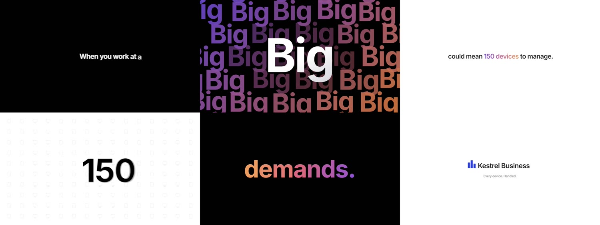
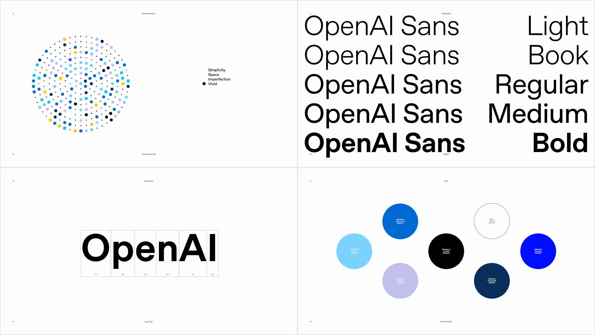

# Bemotion

Prompt-to-video motion graphics for launch-grade SaaS ads. Describe the ad; get an MP4 with real 3D, kinetic typography, camera moves, shader transitions and true motion blur.

Built from scratch: a declarative JSON scene format, a Three.js engine, a live preview, and a headless renderer.

## Example: Kestrel Business


A 29 second Apple keynote style film for a fictional device management product, made entirely from one spec: [`examples/kestrel-business.json`](examples/kestrel-business.json), written by [`scripts/build-kestrel.py`](scripts/build-kestrel.py). One to three words at a time, each line arriving its own way, hard cuts between black and white, a 3D gradient word wall, typing dots, counters, a field of 150 device icons, the count itself becoming the window into the next scene, "IT" morphing into "demands.", and the 3D mark flying into the lockup.



```
node bin/bemotion.mjs render examples/kestrel-business.json -q high            # out/kestrel-business.mp4
node bin/bemotion.mjs render examples/kestrel-business.json -f 9:16,1:1         # vertical and square cuts
```

## Example: a frame-accurate recreation

[](https://streamable.com/99jrq7)

**[Watch the full film (1:57)](https://streamable.com/99jrq7)**

An unofficial recreation of OpenAI's "Refreshed." brand film (2025), rebuilt beat for beat in Bemotion to test how close the engine gets to a hand-made motion design piece. Everything on screen is drawn by the engine from one spec, [`examples/refreshed-recreation.json`](examples/refreshed-recreation.json):

- construction drawings and hairline geometry that cut on the original's exact frames;
- a field of about 280 dots whose positions, sizes and colors follow the original frame by frame;
- a character set that steps through measured row layouts, letters typing in on schedule;
- the wordmark built from its own outline points, a type weight sweep, palette and confetti chapters;
- camera moves that carry through cuts, and motion blur that never smears a hard cut.

It was matched against the original with `bemotion compare`, which scores every moment of a render against a reference video and saves the worst matches side by side. Not affiliated with or endorsed by OpenAI. The spec builds from this repository (`node bin/bemotion.mjs render examples/refreshed-recreation.json`); its footage is in `examples/media/refreshed/`. OpenAI Sans is not redistributable, so the public spec sets the type in Inter.

The same approach recreates Context.dev's "People Search" ad (halftone portraits, a frosted glass search bar, a profile card filmed by a measured camera, a grid of cards collapsing into a stream of dots): [`examples/people-search-recreation.json`](examples/people-search-recreation.json), media in `examples/media/people-search/`. Also unofficial and not affiliated.

## What it does

- **Real 3D scene graph.** Every layer lives in perspective space: tilt a dashboard, float a 3D phone, orbit the camera, put glass and iridescent objects behind your copy.
- **Kinetic typography.** Per-letter, per-word and per-line animation: mask reveals, slams, cascades, scramble, typewriter, tracking. Named line styles (push, plop, scatter, depth, focus pull...) with automatic variety so consecutive lines never arrive the same way, matching exits, gradient type, and morphing text where shared letters glide from one word to the next.
- **Camera direction.** Push-ins, orbits, punch zooms on the beat, handheld drift, shakes, dolly zoom.
- **Cinematic finishing.** Multi-sample motion blur, HDR bloom, chromatic aberration, grain, vignette, dithering.
- **Transitions.** Whip pan, zoom-through, glitch, push, slide, flash, iris, wipe, blur, pixelate, fade, dip to black, and a mask that shows the next scene through a word, number or logo, then dives into it.
- **Shared elements.** Name a layer with `share` in two neighbouring scenes and it flies from one to the other across the transition: a logo becomes the hero, a headline becomes a title, no cut.
- **Product UI components.** Browser window, 3D phone, 3D laptop, cards, buttons with press, cursor with clicks, bar/line/area/donut charts, counters, toasts, progress bars, badges, avatars, code editor with typing, logo marquee, 75+ icons.
- **Continuous storytelling.** Focus blur and camera depth of field with rack focus, shape morphing, motion paths with comet trails, sentence-builder type, a hand cursor whose clicks drive the story, ring/tunnel/scatter layouts, and 3D confetti.
- **Automatic sound design.** Synthesized effects on every animation event, in three kits (soft, tactile, classic), pitched to a scale so word builds play little phrases, with a different key and variations per video.
- **Video clips.** Screen recordings and footage as layers (on their own, inside a phone or laptop screen, behind text), frame exact in renders, with optional sound. Drop a clip onto the preview to add it. `"focus": "auto"` zooms into a recording wherever something happens (typing, menus, panels), like a hand-edited product demo.
- **Music and voiceover.** Drop audio files onto the preview (or pass `--music` / `--voice` to `render`). Music loops, fades out and dips under the voice automatically; the preview plays the whole soundtrack in sync. A music track with `sync` cuts the video to its beats; a voiceover with its `script` and `align` makes each line arrive as it is spoken, with optional captions.
- **Every format.** Design at 16:9 and render 9:16, 1:1 and 4:5 versions from the same spec: text rewraps, wide scenes zoom to fit, and any layer can be adjusted per format.
- **Three directing styles.** Flow (default: bright, continuous product film), Minimal (Apple keynote black and white) and Hype (loud trailer energy).
- **AI-native.** `generate` writes the spec with Claude, validates it, renders frames, has Claude review them like a creative director together with the measured problems of `check` (collisions, text that leaves too soon, still stretches) and revises until both pass. Or let any coding agent use the `make-ad` skill.

## Quick start

```
npm install
node bin/bemotion.mjs preview examples/kestrel-business.json        # live preview with timeline
node bin/bemotion.mjs render examples/kestrel-business.json -q high   # out/kestrel-business.mp4, with sound
```

Requires Node 20+. Chrome and ffmpeg are installed through npm. A GPU is used when available (an RTX-class card renders a 25 s 1080p ad with motion blur in about 30 s).

## From a prompt

With Claude Code (no API key needed): ask for an ad. The `make-ad` skill in `.claude/skills/` guides the agent through writing, checking and rendering.

With the built-in generator. It uses the Claude API when `ANTHROPIC_API_KEY` is set, and otherwise runs headless Claude Code with your signed-in account (`--backend api|claude-code` to choose):

```
node bin/bemotion.mjs generate "Launch ad for Ledgerly, an AI bookkeeping app for freelancers. Clean, Apple-like. 25 seconds. Brand blue #2E6BFF. CTA: Try it free at ledgerly.app" -o projects/ledgerly/ad.json --render
node bin/bemotion.mjs generate "..." -i screenshot.png -i logo.png    # use your own screenshots
node bin/bemotion.mjs generate --url ledgerly.app "25 seconds, calm"  # start from the product's website
node bin/bemotion.mjs generate "..." -n 3                               # three different ads to choose from
```

Name a technique and it comes with a working sample: `generate "... with the LangEase morph into the logo"` or `--ref apple-product-reveal`. The library (`bemotion refs` lists it, `bemotion refs morph logo` searches it, `bemotion refs show <key>` writes a sample to preview) covers the LangEase morph, sentence build, UI tip-up and camera dive, shared elements, the Apple product reveal, the keynote type film, the number mask dive, cursor clicks that cause things, scatter clouds with a focus rack, hype slams, data chart stories, typed prompts the camera follows, and logo end cards. `scripts/build-refs.py` builds it.

With `-n` (up to 4), each variant takes a different direction: a Flow journey with a warm score, a Minimal keynote with an ambient score, a punchy 15-second cut with a bright score, and a customer story. They are written and reviewed in parallel as `ad-flow.json`, `ad-minimal.json` and so on, each with a contact sheet (`ad-flow.png`) to compare them at a glance.

With `--url`, the brand comes from the website first: name, logo (a transparent capture), colors (the brand color is the one on buttons and links, not a stray card), fonts (downloaded when the engine can read them, from Google Fonts by name otherwise, else the closest bundled font), headlines, calls to action, a hero screenshot, distinct sections further down and the large product images. They land in a `brand/` folder next to the spec. `bemotion brand <url>` runs the import alone.

## Commands

| Command | Purpose |
|---|---|
| `validate <spec>` | Schema check and scene timeline |
| `check <spec>` | Play the video headlessly and report text collisions, text that leaves before it can be read and still stretches (`--platform tiktok,reels,shorts` adds text and logos under that app's interface at 9:16; `preview --safe tiktok` draws those areas) |
| `preview <spec>` | Browser preview and visual editor: scrub, play, frame-step, auto-reload on save |
| `hdri list` / `hdri get <id>` | Browse and download Poly Haven studio HDRIs (CC0) for `"environment": "hdri:<id>"` |
| `still <spec> -t 1 4.5 -o f_{t}.png` | Render PNG frames (`-f 9:16` to check a format, `--height 2160` for 4K) |
| `render <spec> -o out.mp4` | Render the video (`-q draft|standard|high`, `--from/--to`, `--no-motion-blur`, `-c` workers, `-f 9:16,1:1,4:5` for vertical and square versions, `--encoder gpu` to encode on an NVIDIA, AMD or Intel GPU). Work is handed out in short chunks so heavy stretches are shared, and frames where nothing moves skip the extra motion blur passes |
| `voice <audio> --script-file script.txt` | When each phrase and word of a voiceover is said (`--json` for every word) |
| `remake <video>` | Start a recreation: finds the shots, writes a contact sheet per shot, measures camera motion, background and colors, and writes a spec with one scene per shot (the reference drawn faintly over each to build against) plus NOTES.md with next steps |
| `compare <spec> <ref.mp4>` | For remakes: score a render against the reference moment by moment and save the worst matches side by side |
| `trace dots\|camera\|text\|reveal\|halftone <video>` | For remakes: measure the reference. `dots` tracks every dot into a `dots` layer file; `camera` gives a scale and shift per frame (and group keyframes) relative to an anchor frame, and reports cuts; `text` fits a line of type (size, baseline, color, a ready text layer) for a given font file; `reveal` finds when each letter appears (`times` for a text animation); `halftone` reads a dot grid into a one-pixel-per-dot image |
| `generate "<prompt>"` | AI writes, reviews and revises a spec (`-u` product website, `-n` variants, `--ref` techniques, `-i` images, `-r` review rounds, `-b auto|api|claude-code`, `--render`) |
| `bench [ids...]` | Runs `generate` on the fixed prompts in `bench/prompts.json` and scores each ad (check findings, length against the brief, optional `--judge` scores from a contact sheet); `--baseline <run>` compares two runs |
| `review <spec>` | Claude reviews rendered frames (mid-scene, settled and halfway through each transition) together with what `check` measures, and revises the spec in place until it passes (`-r` rounds) |
| `say "<text>" -o vo.wav` | Speak a script into a voiceover (`-p system|elevenlabs|openai`, `-v` voice, `--voices`). In a spec, a voice track with `"tts": true` does this itself |
| `refs [words]` / `refs show <key>` | The technique library: search named techniques, write a runnable sample to preview |
| `comments <spec>` | List the review comments left in the preview (press C there to leave one at the playhead; they show on the timeline). `review <spec> --comments` has Claude address the open ones and resolves them |
| `preview <spec> --director` | Auto director: comments become edits by themselves. After a quiet period with no new comments (`--director-wait`, 20 s) the open ones go to one review round (`--director-backend`, `claude-code` by default), which revises the spec and resolves them. Runs never overlap; comments left during one wait for the next. The Comments panel shows its status and has a toggle to switch it on without the flag, and one undo (Ctrl+Z) reverts a revision |
| `cutdown <spec> -l 15,6` | Shorter versions of an ad (`<name>.cut15.json`, `<name>.cut6.json`): keeps the hook, the end card and the scenes carrying the product and its claim, retimes them without rushing any line, prints why each scene stayed or went and checks the result (`-k` scenes to keep, `-f 9:16,1:1`, `--render`) |
| `fill <template> --set name=value` | Fill a template's `{{placeholders}}` (from `--set` or `-d values.json`; missing ones take their slot default) |
| `batch <template> <rows.csv> --render` | One video per CSV row: personalized or translated versions from one template (`-f 9:16` for formats too) |
| `capture <url> [-s css]` | Turn a live page, or one element of it, into editable layers: boxes (fill, border, radius, shadow), one text layer per line in the page's fonts, images and icons, all at their places |
| `brand <url> -o dir` | Import a brand from its website: brand.json with name, colors, fonts, copy, plus the logo, fonts and screenshots |
| `figma <file-link> [-n node] -o dir` | Turn Figma frames into editable layers, one scene per top-level frame (or the frame in the link's `node-id`, or `--page <name>`). Rectangles and ellipses become shapes (fill, gradient, stroke, radius, shadow), frames become groups (clipping as a mask), text becomes text layers in the file's fonts (Google Fonts, else the nearest bundled), simple vectors become `svg` layers from their path geometry, image fills become images, and what the engine cannot draw (blurs, angular gradients, complex vectors) is rendered by Figma to PNG. Needs `FIGMA_TOKEN` (a personal access token with file read access), which is only sent to api.figma.com |

## Visual editor

`bemotion preview <spec>` doubles as an editor. Press **E** (or the Edit button), then click any object in the viewport or pick it in the **Layers** list:

- **Transform:** drag the gizmo to move (**W**), rotate (**R**) or scale (**S**). Alt-click selects the parent group. Type exact values, or drag a property's label left and right to scrub it.
- **Properties:** every property of the layer type, generated from the schema: text, colors (with a picker that understands theme tokens like `$primary`), sizes, materials, fonts, enums. **Add property** lists the ones not set yet; the **Layer JSON** box edits anything else directly.
- **Layers:** **Add** inserts text, shapes, icons, buttons, glows, 3D meshes, images, glTF models or groups into the scene under the playhead. **Duplicate** (**Ctrl+D**), bring forward and send backward (**Ctrl+]** / **Ctrl+[**), and **Delete** (**Del**).
- **Keyframes:** the diamond next to a property toggles a key at the playhead. **K** turns on Auto-key, so every edit records a key; without it, static properties change their base value and animated ones get a key. The timeline shows one row per animated property: drag a diamond to retime it (the "All keys" row moves every key at that time), double-click a row to add a key, Delete removes the selected key.
- **Easing:** selecting a key opens the Keyframe panel with its time, value and ease: pick a named ease or drag the two curve handles for a custom cubic-bezier.
- **Ctrl+Z** / **Ctrl+Shift+Z** undo and redo.

Edits show immediately: only the changed scene rebuilds (about 10 ms), and the file is saved in the background. Every change is written straight into the spec JSON, so the file stays the single source of truth for rendering and for AI edits. Saving the file from another editor updates the preview the same way.

The example generator scripts (like `scripts/build-clipfold.py`) never overwrite a spec that was edited after it was generated; they stop with a message. Pass `--force` to replace it anyway, or `--out <file>` to write the generated version elsewhere.

## Realism

- **Models:** `model` layers load glTF/GLB files (Blender, Spline, Sketchfab) with material overrides and animation playback.
- **Lighting:** real studio HDRIs (`"environment": "hdri:studio_small_09"`), or built-in `softbox` / `studio` rigs; soft shadows onto an invisible floor with `"lighting": { "shadows": true }`.
- **Surfaces:** procedural `finish` maps: brushed, satin, sandblasted, hammered, polished, plus scratches and smudges.

## Writing specs

`docs/SPEC.md` is the full reference: coordinates, timing, every layer type, presets, camera moves, transitions, post-processing, sound, and the directing rules for each style. Start from `examples/kestrel-business.json` (Apple keynote type film), `examples/clipfold-flow.json` (Flow), `examples/tempo-apple.json` (Minimal) or `examples/flowstack-launch.json` (Hype). Dense UI is easiest to author with a small generator script, like `scripts/build-clipfold.py`.

```json
{
  "fps": 30,
  "scenes": [
    {
      "duration": 3,
      "camera": { "moves": [{ "preset": "pushIn", "amount": 80 }] },
      "layers": [
        { "type": "background", "style": "solid", "color": "#000000" },
        { "type": "glow", "size": 1500, "color": "#3B82F6", "intensity": 0.13 },
        { "type": "text", "text": "Meet Tempo.", "size": 132, "color": "#F5F5F7",
          "animate": { "preset": "mask", "by": "word", "stagger": 0.14 } }
      ]
    }
  ]
}
```
